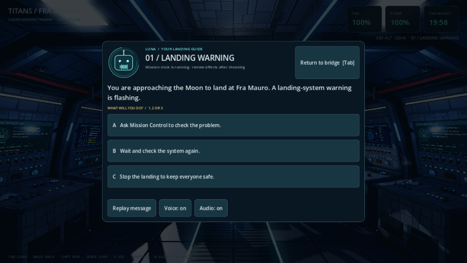
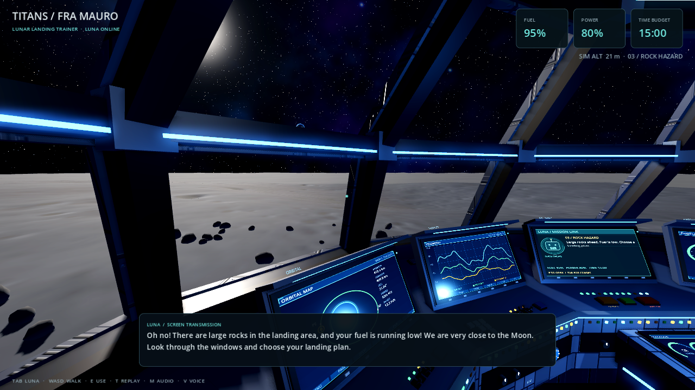
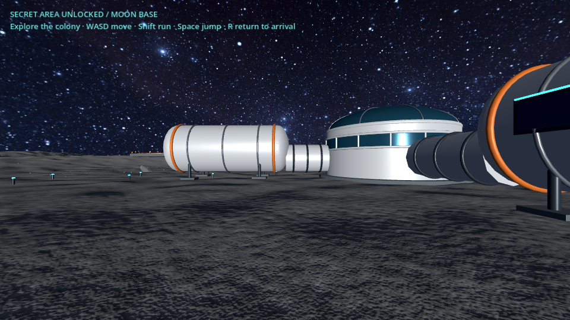

# TITANS · Fra Mauro Landing

A first-person lunar landing training mission inside the supplied Sci-Fi Space
Bridge. The astronaut's walking/camera effects remain intact. LUNA, a scripted
robot guide, speaks from the ship's screens and guides three branching scenarios.

## Play

1. Extract the entire ZIP into a fresh folder.
2. Import `project.godot` in **Godot 4.6 or newer**, standard edition.
3. Wait for asset import, then press **F5**. No plugins, API keys or internet are
   needed at runtime. The ZIP includes the narration, sound effects and lunar data.
4. The timer starts immediately, with comms closed. Wait for the mission alert,
   then press **Tab**. After choosing, review the effects and select **Continue**.
   The next mission arrives after a short interval; it never forces the panel open.



## Controls

| Input | Action |
|---|---|
| W / S | Walk forward / backward relative to your view |
| A / D | Strafe left / right |
| Hold Shift + W/A/S/D | Run in any movement direction (including diagonals) |
| Space | Jump when on the floor; one jump per press |
| Mouse | Look around |
| E / left click | Use a highlighted physical control within 2.4 m |
| Tab | Open/close the LUNA mission panel |
| 1 / 2 / 3 | Choose A / B / C while the choice panel is open |
| T / Replay message | Replay LUNA's current mission message |
| M | Mute/unmute all audio |
| V | Pause/resume the guide voice independently |
| Esc | Close comms; when already closed, release the cursor |
| Left click after releasing cursor | Resume mouse look without operating a switch |
| R | Reset astronaut position at the bridge entry; mission progress is retained |
| Restart training button | Reset the whole mission, resources, flight and choices |

LUNA is visible on the central front display and both rear side displays. Aim at
one and press E to open her channel. Other switches, displays, warnings and the
sliding door remain interactive. The old O2 demo is disabled during this mission.

## Three scenarios and costs

The choice costs match the user's table. A percentage cost subtracts percentage
points of the starting capacity. The **20-minute countdown runs immediately and
continuously**, including exploration, conversations and mission intervals. The
original fixed choice-time penalties are also subtracted after each completed physical task. Costs
and outcomes are hidden from the option buttons and shown only after the task is completed.

| Scenario | Choice | Fuel cost | Power cost | Time cost |
|---|---|---|---|---|
| Landing warning | A: contact Mission Control | 0 | 5 | 3 min |
| Landing warning | B: wait, then Mission Control | 0 | 5 | 7 min |
| Landing warning | C: abort | Unspecified / unchanged | Unspecified / unchanged | Ends landing |
| Radar failure | A: troubleshoot radar | 10 | 5 | 5 min |
| Radar failure | B: backup height sensor | 5 | 15 | 2 min |
| Radar failure | C: visual observation | 5 | 0 | 1 min |
| Final landing | A: landing lights | 10 | 10 | 2 min |
| Final landing | B: land between rocks | 5 | 0 | 1 min |
| Final landing | C: fly to clear area | 25 | 5 | 4 min |

Two ambiguities in the original story are resolved explicitly:

- Scenario 1 B continues to Scenario 2 because Mission Control eventually fixes it.
- Landing lights improve visibility but do not select a landing site. Scenario 3 A
  turns them on once; the player must then choose B or C, paying that choice's
  additional costs. The same lights cannot be charged twice.

## Endings

| Ending | Implemented rule |
|---|---|
| Secret — Fra Mauro Pathfinder | Safe landing, prompt Mission Control contact, reliable radar/backup height data, fuel >=70%, power >=75%, and time >=7 min |
| Good (normal) — Safe Touchdown | Reliable height and clear-zone landing, but not every secret condition |
| Bad — Unsafe Landing Attempt | Land too near rocks, commit without reliable height data, or exhaust a required resource |
| Safe — Crew Safe / Landing Aborted | Choose C in Scenario 1 and return to orbit |

The A → B → C path retains **70% fuel / 75% power**. Remaining time is now
**11 minutes minus real elapsed play time**, so the secret ending also requires
finishing before this remaining value drops below 7 minutes. Waiting in Scenario 1 prevents a secret ending but permits a normal safe
landing later. Visual-only height data does not count as reliable. A height-data
failure stops the simulated approach above the surface; an unsafe rock landing
is debriefed without a violent crash scene.

With the supplied one-time costs, no path naturally exhausts all of a resource.
The exhaustion check is implemented for future balancing; the real-time countdown can now exhaust the mission time even without choices.
Fuel and power still use only the original choice costs.

## LUNA and audio

LUNA is a scripted educational guide with bundled synthetic English narration,
not a networked chatbot. The voice uses offline CMU Flite SLT synthesis and is
played from the nearest physical guide monitor. The monitor and comms avatar
animate their mouths from the speech amplitude envelope. Every spoken line also
appears as subtitles; replay, voice mute and master mute are available.

The original soundscape includes cabin ventilation, restrained engine vibration,
soft boot/suit footfalls, switch tones, radio-style cues, warning pulses, door
servos, touchdown and ending chimes. These are sounds heard *inside the pressurized
spacecraft*. The game does not play outdoor wind or sound traveling through a
vacuum. Ambience ducks while LUNA speaks. See `CREDITS_AUDIO.txt` for speech-tool
notices and procedural-sound provenance. Runtime audio is bundled WAV, independent
of installed OS voices.

## Lunar data actually included



- **NASA LROC NAC_DTM_APOLLO14 v1.9** elevation source, sampled at 2 m/pixel.
- A **513 × 513** crop, approximately **1.024 km square** between sample centers,
  around the reported historical Fra Mauro site at 3.64530°S, 17.47136°W.
- Matching **M150633128 2 m orthophoto**, cropped on the same grid.
- The georeferenced float source crop, relative-height and numeric-slope arrays,
  a slope preview, source label/README, and metadata including original SHA-256s.
- A **4 m display mesh** sampled from the full 2 m data for runtime performance.
- Decorative grain extracted from the user's `moon(1).glb` embedded texture.

The provided GLB was a terrain patch with an embedded surface image, not a whole
Moon sphere. Its image is used as secondary surface detail. The visible measured
terrain geometry and primary imagery come from the downloaded LROC products.

The historic coordinates can differ from modern cartographic landing positions.
Rocks, the extended distant background, flight altitude, backup sensor and resource
costs are authored game content. A low terrain slope is not enough to validate a
real spacecraft landing site. The sci-fi bridge is a fictional training craft,
not an Apollo Lunar Module replica. The in-game NASA-data tab was removed as requested; these source and simulation
distinctions remain documented here and in the scientific metadata files.

Sources:

- [NASA Apollo 14 summary](https://www.nasa.gov/wp-content/uploads/static/history/SP-4029/Apollo_14a_Summary.htm)
- [NASA Reprogramming in Flight](https://www.nasa.gov/wp-content/uploads/static/history/SP-350/ch-7-4.html)
- [LROC Apollo 14 terrain group](https://data.lroc.im-ldi.com/lroc/view_rdr/NAC_DTM_APOLLO14)
- [Matching LROC orthophoto](https://data.lroc.im-ldi.com/lroc/view_rdr_product/NAC_DTM_APOLLO14_M150633128_2M)

Credit: NASA/GSFC/LRO/LROC team. Source producer and methodology are retained in
`assets/moon/SOURCE_DEM.LBL` and `SOURCE_README.txt`. Large full-resolution originals
were used for processing but are omitted from the game ZIP; the cropped data used
by the game are included. Full URLs, acquisition information and hashes are in
`assets/moon/terrain_metadata.json`. Retrieved 2026-11-15.

## Project map

| File | Purpose |
|---|---|
| `Main.tscn` | Main bridge + astronaut + lunar world + mission + audio |
| `scripts/LandingMission.gd` | Branching state machine, resources, warnings and endings |
| `scripts/MissionInterface.gd` | Comms choices, resource HUD, subtitles and data briefing |
| `scripts/LunaScreen.gd`, `LunaPortrait.gd` | Actual 3D monitor UI and shared animated avatar |
| `scripts/FlightAudio.gd` | Localized voice, ambience, SFX and mute controls |
| `scripts/LunarWorld.gd` | Measured terrain mesh, authored rocks and visual descent |
| `scripts/MissionTasks.gd` | Physical objectives, control panel and voiced waypoint guidance |
| `scripts/EndingCinematic.gd` | Four ending camera sequences, captions and contact effects |
| `mission/scenarios.json` | Editable scenario choices, costs and safety policy |
| `mission/voice_lines.json` | Spoken lines and corresponding subtitles |
| `assets/audio/` | Bundled WAVs and speech envelopes |
| `assets/moon/` | Measured crop, imagery, source metadata and user texture |
| `Player.tscn`, `scripts/Astronaut.gd` | Preserved first-person astronaut controls/effects |
| `tools/build_lunar_assets.py` | Reproduce crop from original source files |
| `tools/generate_audio.py` | Regenerate synthetic SFX/voice on a development machine |

The two generation tools are development helpers requiring their documented
Python/Flite dependencies; they are not needed to run the game. Original cockpit
screenshots, unused orbit-camera source and the earlier data guide are retained
as references. New screenshots shown above are rendered from this integrated game.

## Validation

Tested with Godot **4.6.3**:

- All **24 completed landing paths**, including landing-light follow-up choices.
- Safe abort, future resource depletion, all four endings, exact cost arithmetic.
- Duplicate-choice protection, single-charge lights, reset/restart and keyboard
  choices, monitor takeover, narration assets and independent audio controls.
- Preserved walking, view-relative movement, camera bob, physical controls, door
  passage, occupancy protection and interaction occlusion.
- All 72 interior controls reachable from connected standing positions.
- Native graphical renders of the briefing, choices, physical LUNA monitors,
  lunar terrain, landing lights and post-landing debrief using Compatibility/CPU
  rendering. The game retains the supplied project's Forward+ default renderer.
- Scientific crop size, valid elevations, source checksums, height reference,
  aligned image grid, slope array and packaged file integrity.

Optional command-line regression checks after importing assets:

```sh
godot --headless --editor --import --quit
godot --headless --fixed-fps 60 --path . --script res://tests/landing_mission_test.gd
godot --headless --fixed-fps 60 --path . --script res://tests/bridge_integration_test.gd
godot --headless --fixed-fps 60 --path . --script res://tests/control_accessibility_test.gd
```

Headless runs load and validate voice resources without starting an audio device.
Normal graphical gameplay starts the included audio automatically.

## Run and jump update

Hold Shift with any WASD direction to run at 3.0 m/s; releasing Shift returns to
1.5 m/s walking. Diagonals are normalized. Space jumps once from the floor, using
a 1.35 m/s launch velocity and the existing 1.62 m/s² moon gravity. The cabin roof
and overhead panels still block upward movement. Holding Space does not trigger
repeated jumps, and opening LUNA comms disables movement/jumping until closed.

The supplied `run` animation is used during ground running, while `Moon_Walk`
remains the walking clip. Footfall cadence follows movement speed and stops
while airborne. Camera position follows the physical jump; grounded head bob
and lean remain available. Select Astronaut to tune Run Speed or Jump Velocity.

## Completed mission-flow and Moon-base integration

- LUNA comms starts closed and opens only when the player requests it (Tab or a
  physical guide monitor). No mission/debrief is forced open automatically.
- The first alert appears after 10 seconds; following missions wait 8 seconds
  after Continue. Both delays are editable on LandingMission in the Inspector.
- An amber alert explicitly asks the player to press Tab.
- Choice buttons contain only their action text. Resource changes appear in the
  result panel after you use the mission control.
- The 20-minute timer runs during walking, listening, open comms, delays and
  physical tasks. It stops when the final flight command commits the ending,
  so noninteractive ending shots do not consume the player’s time budget.
  Original choice-time penalties still apply.
- Only the secret ending transfers to `moon_base/MoonBase.tscn`, automatically
  after LUNA's ending transmission. Other endings remain in the bridge.
- The base uses the supplied Part 1 `node_3d.tscn` layout and its referenced colony,
  lander, Sun and sky. It keeps the current astronaut with sprint/jump and uses a
  ground/clearance-checked arrival point, plus an outdoor fall-reset threshold.

**All three archives checked:** Part 1 supplies the source project and the
Moon-base scene's required assets. Part2.zip contains only generated Godot editor
and import-cache files (194 files); Part3.zip also contains only generated import
cache files (66 files). Their archive integrity checks passed. They add no source
scenes, scripts or models needed by the game. Godot regenerates these caches when
you import this project, so no cache files are included in the final package.
The completed game retains the base scene and all six requested mission-flow
changes, including the running and jumping controls.

The copied source layout is namespaced under `moon_base/` to avoid replacing
the current mission, audio, player or bridge scripts with older copies. The sky
image was reduced from 16384×8192 to 4096×2048 for runtime memory; its appearance
and role are retained.

Additional regression check:

```sh
godot --headless --fixed-fps 60 --path . --script res://tests/mission_flow_test.gd
```




## Practical tasks and ending cutscenes

Secret-ending time is now **at least 7:00**, inclusive. Fuel >=70%, power >=75%,
reliable altitude and safe decisions are still required. A → B → C is the
Pathfinder route; its 11-minute balance allows about four minutes of actual
walking, listening and mission intervals before the final flight command.

Choosing A/B/C assigns an objective and closes comms. Follow the cyan world
marker and the distance/direction hint, aim at the indicated control, and press
**E** (or left click). LUNA speaks instructions from the bridge monitors. The
choice’s costs and outcome apply once, after the physical task is completed.
Other switches cannot complete the objective. Tab reopens the task instructions;
T repeats LUNA’s directions. Existing controls remain usable.

| Mission | Plan | Physical action |
|---|---|---|
| Landing warning | A | Use S-BAND / Mission Control uplink on the left aft communications console. |
| Landing warning | B | Acknowledge MASTER CAUTION on the front dashboard, wait four seconds for the recheck, then use the S-BAND uplink. |
| Landing warning | C | Press the red ABORT / RETURN TO ORBIT button beside the rear door. |
| Radar failure | A | Switch RADAR OFF, then ON, at the right aft sensor console. |
| Radar failure | B | Switch on BACKUP HEIGHT SENSOR / LIDAR at the right aft sensor console. |
| Radar failure | C | Reach the port canopy observation marker, look out and press E to report the surface. |
| Final landing | A | Activate EXT LIGHTS on the overhead panel, then select a landing site. |
| Final landing | B | Press amber COMMIT: BETWEEN ROCKS beside the rear door. |
| Final landing | C | Press cyan DIVERT: CLEAR LANDING ZONE beside the rear door. |

The new rear flight panel is mounted to the wall and does not occupy the aisle.
The sensor uses the original LIDAR switch. The window target is an observation
interaction, rather than a pretend altitude measurement.

Four in-engine ending sequences use an interior approach shot, an exterior
tracking shot and a final outcome shot, with captions, fades, engine/alert cues
and contact effects. Good and secret endings show controlled touchdown; secret
adds a wider reveal and then the existing automatic Moon-base arrival. The safe
ending shows the ship climbing away. Bad outcomes show hard contact by boulders,
a suspended approach without altitude data, or a resource-failure blackout.
Flight controls and comms are locked during the sequence, then restored for the
debrief. Restart restores the first-person camera and clears all objectives.

Additional regression commands (from the project folder):

```sh
godot --headless --fixed-fps 60 --path . --script res://tests/practical_cinematic_test.gd
godot --headless --fixed-fps 60 --path . --script res://tests/landing_mission_test.gd
godot --headless --fixed-fps 60 --path . --script res://tests/control_accessibility_test.gd
```
